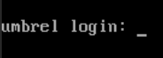
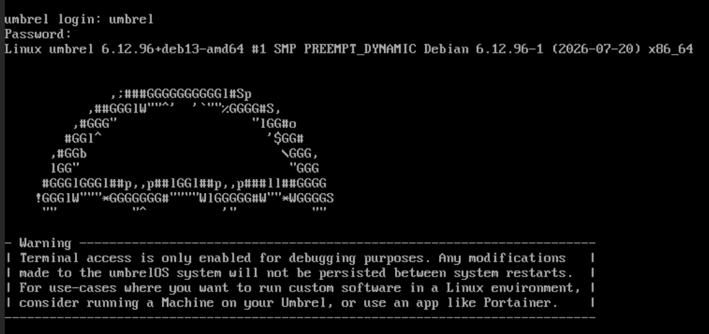
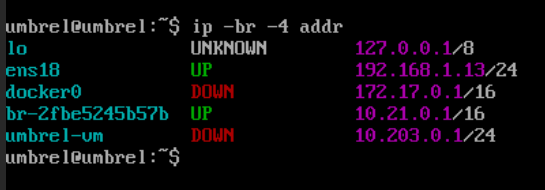
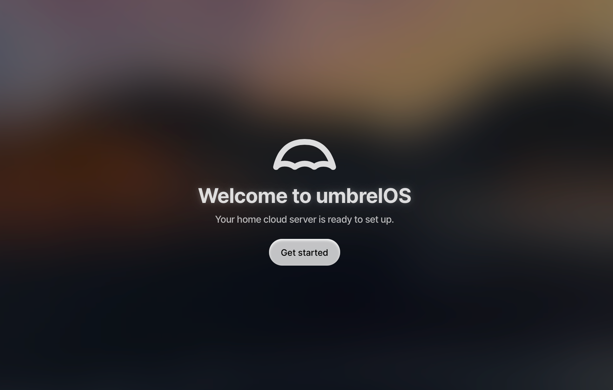

<h1>Accès et configuration</h1>

UmbrelOS est accessible en webadmin, pour y accéder, il faut trouver l'adresse IP attribué

- Lorsque la VM se demarre, se menu apparaitra


- Saisir l'utilisateur et mot de passe par defaut - umbrel / umbrel

#### UmbrelOS est désormais en mode "Terminal access"


- Saisir la commande suivante:

```
ip -br -4 addr
```

- Noter l'adresse IP qui se situe sur l'interface e#### (ex. ens18)


- Sur un autre poste, saisir l'adresse IP noté dans un navigateur (ex. https://192.168.1.13)

#### La page suivante s'affichera


- En cliquant sur "Get Started", on peut choisir un nom d'utilisateur et confirmer deux fois le mot de passe
