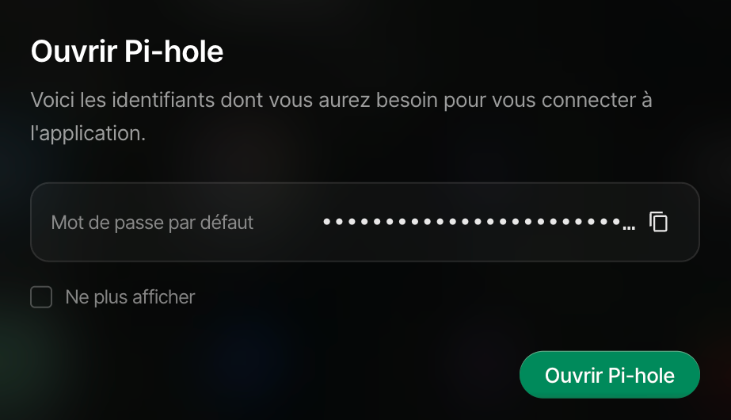

<h1>Déploiement Services</h1>

### Les Fonctionalités qu'on va installer sur notre serveur:

#### Électronique
- **<a href="https://www.home-assistant.io/">Home Assistant</a>** - permet de gerer ses appareils connecté dans sa maison - tout en local permettant de faires des automations
- **<a href="https://mosquitto.org/">Mosquito</a>** - serveur MQTT permettant de s'abonner a des informations ex. portes garage fermé/ouverte

#### Réseau
- Monter un disque en réseaux a l'aide d'un partage SMB hebergé sur le serveur (adresse UNC sur Windows)
- **<a href="https://rustdesk.com/">RustDesk</a>** - service de prise de controle pour acceder des differents appareils dans son réseau a distance

#### Cybersecurité
- **<a href="https://tailscale.com/">Tailscale</a>** - Permet de acceder notre serveur hors réseaux LAN - tout en ayant pas besoin de ouvrir a un port sur son routeur et s'exposer eventuellement a une faille de securité
- **<a href="https://pi-hole.net/">Pi-Hole</a>** - Notre propre DNS qui permet de filtrer les requetes pertitantes et de bloquer les sites de publicité et malveillants

#### **Tous les services se trouvent dans l'App Store de UmbrelOS**

#### **Il suffit de cliquer sur "Installer" et cliquer sur l'icon du service en question lorsque l'installation à fini**

**Cela ouvrera la page du service avec les identifiants par defaut et le port qui lui correspond**
