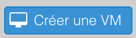
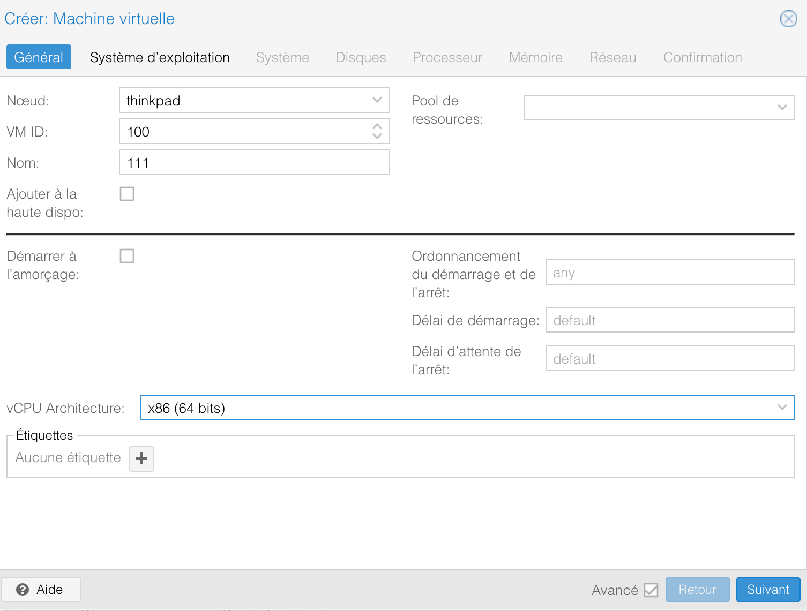
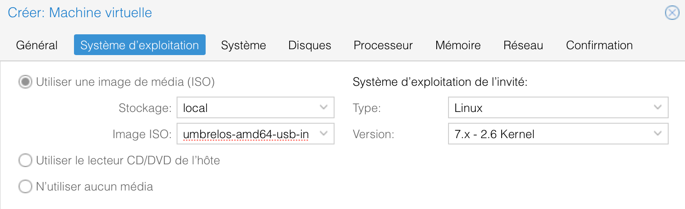
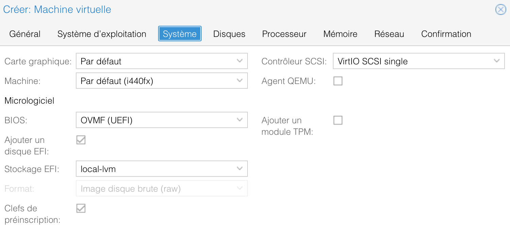
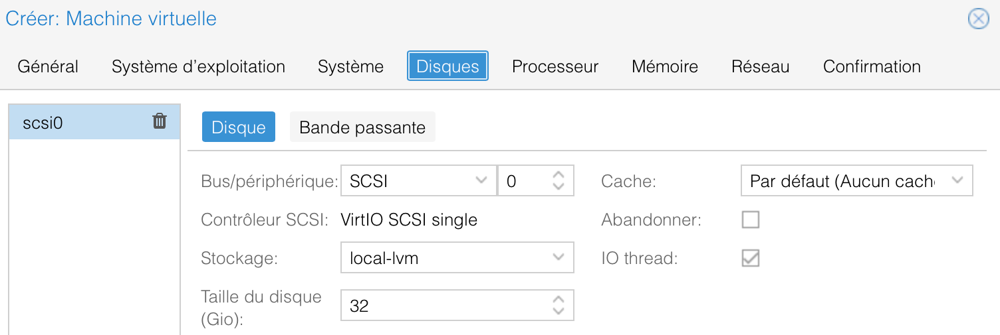
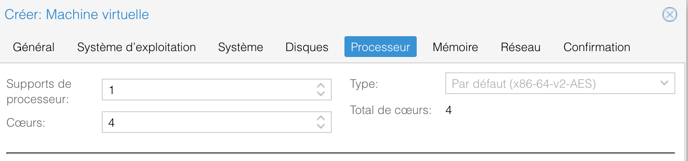
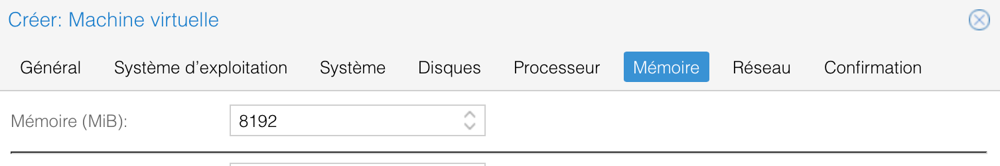
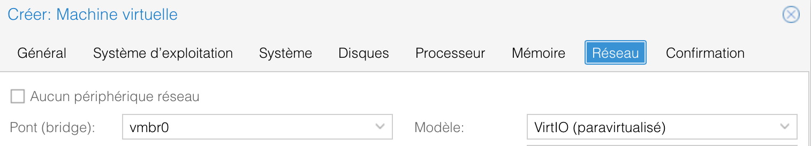
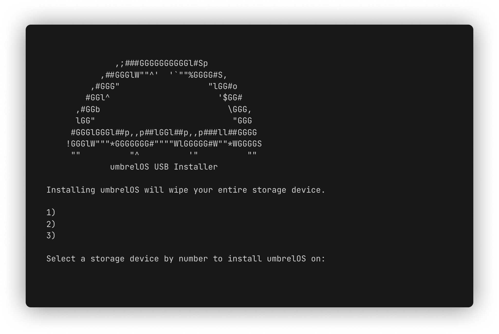

<h1>Installation</h1>

L'installation ce fera sur un serveur d'entreprise Dell PowerEdge R420 sur l'hyperviseur Proxmox

# Prérequis
- Télécharger le fichier ISO depuis <a href="https://umbrel.com/downloads">le site d'Umbrel</a>
- Avoir accès au serveur Proxmox en LAN
- Sur Proxmox aller dans la partie "local (nom d'hôte)" --> "Images ISO", cliquer sur "Téléverser" et choissiser le fichier ISO
  

Création de la VM

- Cliquer sur "Créer une VM"

- Préciser un nom pour la VM (ex. "UmbrelOS"), cocher la case "Avancé, puis cliquer sur le menu "vCPU architecture" et préciser x86 (64 bits). Umbrel os ne demarrera pas sinon

- Dans la section "Système d'exploitation, preciser le fichier iso qu'on vien de téléverser dans la case "Image ISO". Laisser le reste par defaut.

- **Important** Dans "système", selectionner OVMF (UEFI) et preciser l'emplacement du stockage EFI "local-lvm". **Sans cela, umbrelOS de pourra pas demarrer**

- Partie "Disques" - prévoir au minimum 32 Go pour le système d'exploitation

- Processeur ---> 4 Coeurs recommandé

 
- Mémoire ---> minimum 4Go - 8 Go recommandé

- Réseau ---> préciser carte réseaux dans "Pont (bridge)" - cela nous donnera une adresse ip a nous connecter au server lorce qu'on le demarre

 

- Choisir sur quelle moyen de stockage installer umbrelOS a l'aide des touches du clavier de la liste
