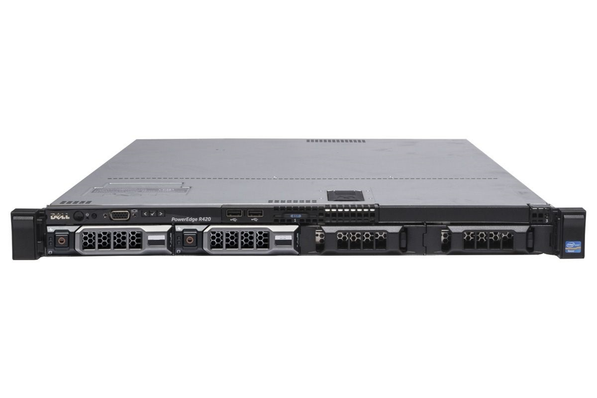

<h1>Projet UmbrelOS Serveur</h1>

  
  
<h1>Configuration et installation de UmbrelOS sur un serveur d'entreprise  Dell PowerEdge R420</h1>

## <a href="https://github.com/evanathanasiou/Projet-UmbrelOS-Serveur/blob/656e6d6c9d6a114f9ba93eb6bc245ed612f2a054/Introduction.md">Introduction</a>

## <a href="https://github.com/evanathanasiou/Projet-UmbrelOS-Serveur/blob/main/Installation.md#installation">Installation</a>

## <a href="https://github.com/evanathanasiou/Projet-UmbrelOS-Serveur/blob/656e6d6c9d6a114f9ba93eb6bc245ed612f2a054/Accces-configuration.md">Accès et configuration</a>

## <a href="https://github.com/evanathanasiou/Projet-UmbrelOS-Serveur/blob/38b8be4b353dc0d90da3a8bbc5703693ae918320/Deploiement-services.md">Déploiement services</a>

## Critères d'installation

**Intel ou AMD :**
- 64-bit - Laptops, PC, NAS, ou Serveur.
- Minimum : Deux-Coeurs CPU (4 Coeur conseillé), 4 GB RAM (8 GB+ conseillé)
- Une clé USB de 4 Go pour umbrelOS.

**Raspberry Pi 5:** booter depuis une clé USB ou une carte microSD

**Machine Virtuelle (VM):** Proxmox, VirtualBox, VMware - tout hyperviseur qui supporte "EFI boot"

 
