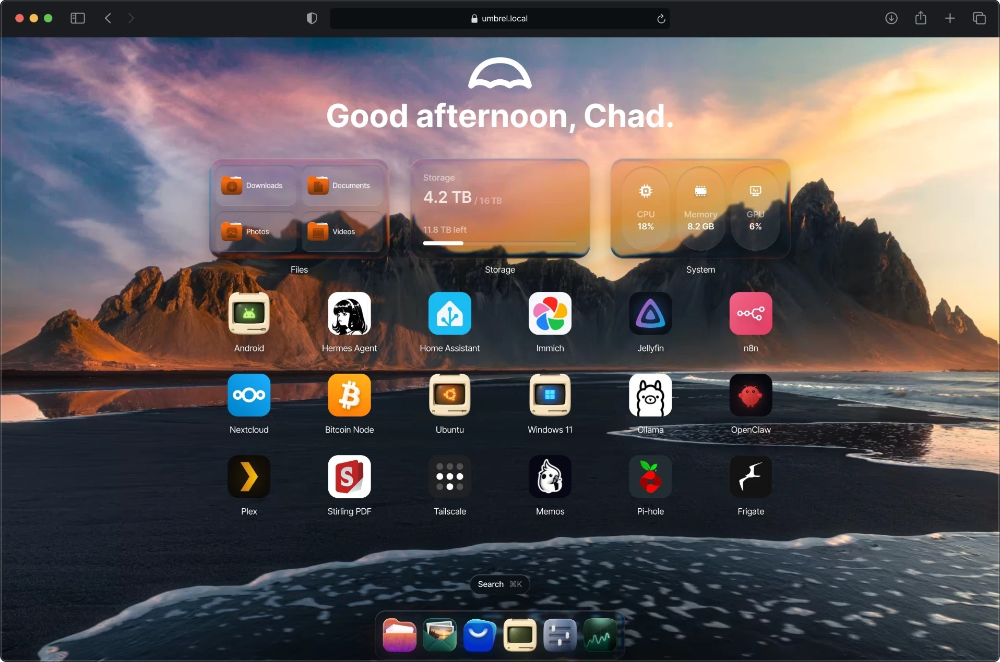

# Projet-UmbrelOS-Serveur

  <h1>Configuration et installation de UmbrelOS sur un serveur d'entreprise  Dell PowerEdge R420
</h1>
  

### Installation
Voir <a href="https://github.com/evanathanasiou/Projet-UmbrelOS-Serveur/blob/main/Installation.md#installation">Installation</a>

## Building apps for umbrelOS

[umbrel.com](https://umbrel.com)
