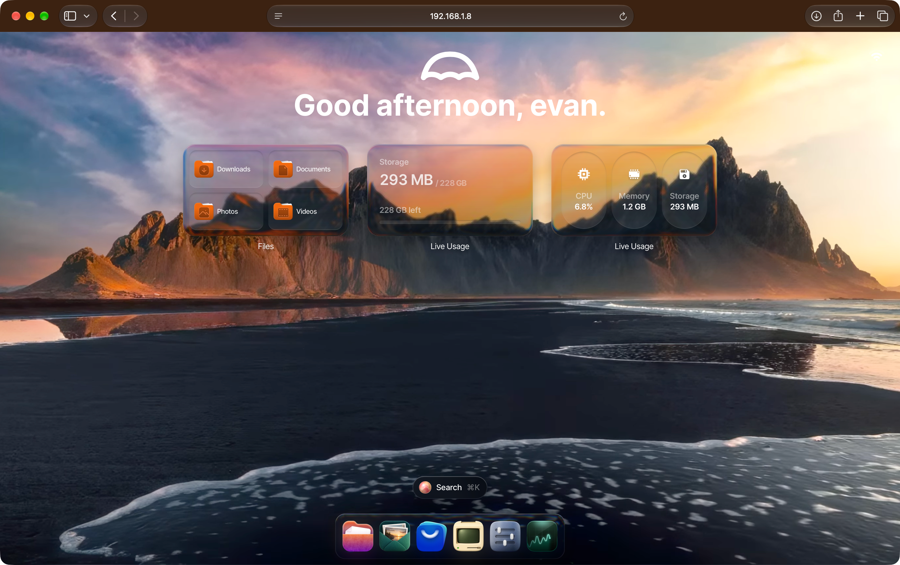

<h1>Projet UmbrelOS Serveur</h1>

  
  
<h1>Configuration et installation de UmbrelOS sur un serveur d'entreprise  Dell PowerEdge R420</h1>

## Installation
<a href="https://github.com/evanathanasiou/Projet-UmbrelOS-Serveur/blob/main/Installation.md#installation">Installation</a>

## Critères d'installation

- **Intel ou AMD :** 64-bit - Laptops, PC, NAS, ou Serveur. Minimum : Deux-Coeurs CPU (4 Coeur conseillé), 4 GB RAM (8 GB+ conseillé), et une clé USB de 4 Go pour umbrelOS.
- **Raspberry Pi 5:** booter depuis une clé USB ou une carte microSD
- **Machine Virtuelle (VM):** Proxmox, VirtualBox, VMware - tout hyperviseur qui supporte "EFI boot"

 
